# 24_PHASE_1_MANUAL_TESTING_GUIDE

## Construction Equipment Rental Management System (CERMS)
### Phase 1 End-to-End Manual UI Testing (ClickOps), Business Logic & Verification Guide

---

## 1. Document Overview & Testing Objectives

This document provides a comprehensive, sequential, click-by-click Manual User Interface (ClickOps) Testing Guide for **Phase 1** of the CERMS platform. 

It is designed for Quality Assurance (QA) engineers, Product Managers, Operations Leads, Accountants, and Developers to validate:
1. **End-to-End Operational Lifecycle:** Complete commercial sequence from fleet master provisioning, customer onboarding, multi-asset quoting, managerial approvals, and contract conversion to physical yard dispatch, return inspection, automated invoicing, payment settlement, and escrow deposit release.
2. **Role-Based Access Control (RBAC):** Verification of permissions, menu visibility, and view protections across all 8 distinct system roles in both the Web UI and the Django Admin panel.
3. **Double-Booking & Conflict Prevention Engine:** Validation that machinery assigned to active contracts, multi-asset contract items, or accepted/approved quotations cannot be reserved or double-booked for overlapping date intervals.
4. **Maintenance & Breakdown Soft Warnings:** Verification that assets under repair are not hard-blocked from forward quotations (for future dates), but display prominent managerial warnings to ensure repair timelines are verified prior to contract conversion.
5. **Physical Logistics Inspection & Bifurcated Damage Routing:** Handover certification with opening/closing hour meters, fuel percentage levels, and decoupled damage routing (minor cosmetic defects vs. grounding workshop maintenance).
6. **Automated Return-to-Invoice Trigger:** Automatic calculation and tax invoice generation upon return inspection check-in without requiring manual intervention from accounting staff.
7. **Financial Engine & Sri Lankan Statutory VAT:** High-precision arithmetic verification of daily/weekly/monthly rate cards, excess operating overtime penalties, mobilization transport fees, 18% VAT, and security deposit deductions.
8. **Automated WeasyPrint Document Generation:** Pixel-perfect A4 PDF generation for Quotations, Binding Rental Contracts, and Commercial Tax Invoices.
9. **Interactive FullCalendar Scheduling Grid:** Timeline, month, and week views reflecting live fleet statuses, color-coded event bars, conflict modal checks, and direct REST API integrations.
10. **System Auditability & Timestamping:** Verification that `TimeStampedModel` attributes (`created_at`, `updated_at`, and `created_by`) automatically record the authoring user across all modules.

---

## 2. Test Environments, Accounts & Data Seeding

### 2.1 Test Environments
* **Staging Server:** `http://43.204.149.39/` (Production-mirrored MariaDB 10.11 & NGINX)
* **Local Development:** `http://127.0.0.1:8000/`

---

### 2.2 Database Seeding Commands

QA testers can quickly set up fresh test data using Django management commands:

1. **Baseline Initial Seeder:**
   ```bash
   python manage.py seed_initial_data
   ```
   *Creates the 8 core RBAC groups, default superuser, 4 demo staff accounts, 6 equipment categories, base fleet assets, and rate cards.*

2. **Realistic Scale Seeder (Recommended for Comprehensive QA):**
   ```bash
   python manage.py seed_dummy_data
   ```
   *Creates 10 realistic corporate construction customers, 10 project sites, 50 equipment assets across multiple categories, 50 rental rate cards, and 20 rental contracts across different lifecycle statuses (`ACTIVE`, `ON_RENT`, `RETURNED`, `CLOSED`) with linked dispatch/return logs, security deposits, and tax invoices.*

---

### 2.3 Default Staff Test Accounts Matrix

| Username | Password | Organizational Role | Core System Responsibilities & Permissions |
| :--- | :--- | :--- | :--- |
| `admin` | `Admin@CERMS2026!` | **Administrator** | **Full System Superuser.** Access to all Web UI views, Django Admin (`/admin/`), user creation, role assignment, and system configuration. |
| `management` | `Staff@CERMS2026!` | **Management** | **Executive Oversight & Approval Authority.** View dashboards, financial reports, high-exposure credit overrides, and quotation approval transitions. |
| `rental_officer` | `Staff@CERMS2026!` | **Rental Officer** | **Customer & Commercial Operations.** Full CRU on Customers, Project Sites, Quotations, Rental Contracts, and Availability Calendar. |
| `ops_officer` | `Staff@CERMS2026!` | **Operations Officer** | **Fleet Logistics & Site Movements.** Full CRU on Equipment Dispatch, Return Handover inspections, checklist logs, and hour-meter audits. |
| `workshop_mgr` | `Staff@CERMS2026!` | **Workshop Manager** | **Maintenance & Fleet Health.** Full access to Equipment status overrides (`MAINTENANCE`, `BREAKDOWN`, `AVAILABLE`), inspection reports, and workshop job cards. |
| `accountant` | `Staff@CERMS2026!` | **Accountant** | **Billing & Financial Settlement.** Full CRU on Tax Invoices, Payment Receipts, Security Deposit Ledgers, and Customer Credit Limits. |
| `storekeeper` | `Staff@CERMS2026!` | **Storekeeper** | **Yard & Inventory Control.** Inventory logs, asset storage locations, and yard handover verification. |
| `field_officer` | `Staff@CERMS2026!` | **Field Officer** | **On-Site Operations & Mobile Checklists.** Mobile-optimized entry for hour-meter readings, fuel logs, delivery signatures, and asset photos. |

---

### 2.4 Role-Based Access Control (RBAC) Permission Matrix

| Module / Action | Target URL Route | Admin | Management | Rental Officer | Operations Officer | Workshop Manager | Accountant | Field Officer | Storekeeper |
| :--- | :--- | :---: | :---: | :---: | :---: | :---: | :---: | :---: | :---: |
| **Django Admin Panel** | `/admin/` | ✅ | ❌ | ❌ | ❌ | ❌ | ❌ | ❌ | ❌ |
| **Fleet Master CRUD** | `/fleet/equipment/` | ✅ | 👁️ (Read) | 👁️ (Read) | 👁️ (Read) | ✅ | 👁️ (Read) | 👁️ (Read) | 👁️ (Read) |
| **Rate Card Management** | `/fleet/equipment/<code\>/` | ✅ | ✅ | ✅ | ❌ | ❌ | 👁️ (Read) | ❌ | ❌ |
| **Customer Master CRUD** | `/rentals/customers/` | ✅ | 👁️ (Read) | ✅ | 👁️ (Read) | ❌ | ✅ | ❌ | ❌ |
| **Quotation Creation** | `/rentals/quotations/create/` | ✅ | ✅ | ✅ | ❌ | ❌ | ❌ | ❌ | ❌ |
| **Quotation Approval** | `/rentals/quotations/<no\>/transition/` | ✅ | ✅ | ❌ (Cannot Approve Self) | ❌ | ❌ | ❌ | ❌ | ❌ |
| **Contract Conversion** | `/rentals/quotations/<no\>/` | ✅ | ✅ | ✅ | ❌ | ❌ | ❌ | ❌ | ❌ |
| **Equipment Dispatch** | `/rentals/contracts/<no\>/dispatch/` | ✅ | 👁️ (Read) | 👁️ (Read) | ✅ | ❌ | ❌ | ✅ | ❌ |
| **Equipment Return** | `/rentals/returns/<id\>/` | ✅ | 👁️ (Read) | 👁️ (Read) | ✅ | ❌ | ❌ | ✅ | ❌ |
| **Availability Calendar** | `/rentals/availability-calendar/` | ✅ | ✅ | ✅ | ✅ | ✅ | ✅ | ✅ | ✅ |
| **Final Invoice Trigger** | Auto on Return / Contract view | ✅ | ✅ | 👁️ (Read) | ❌ | ❌ | ✅ | ❌ | ❌ |
| **Payment Settlement** | `/finance/invoices/<no\>/pay/` | ✅ | ✅ | ❌ | ❌ | ❌ | ✅ | ❌ | ❌ |
| **Security Deposit Ledger** | `/finance/deposits/` | ✅ | ✅ | 👁️ (Read) | ❌ | ❌ | ✅ | ❌ | ❌ |
| **WeasyPrint PDF Exports** | `.../pdf/` routes | ✅ | ✅ | ✅ | ✅ | ✅ | ✅ | ✅ | ✅ |

*Legend: ✅ = Full Access (Create, Read, Update) | 👁️ = Read-Only Access | ❌ = HTTP 403 Forbidden / Access Denied*

---

## 3. Strict Sequential Execution Flowchart

To prevent relational dependency errors, manual testing must proceed in the following order:

```mermaid
flowchart TD
    S1[Step 1: Auth, Session & RBAC Enforcement] --> S2[Step 2: REST API & JWT Token Auth]
    S2 --> S3[Step 3: Fleet Category Setup]
    S3 --> S4[Step 4: Equipment Asset Master Registration]
    S4 --> S5[Step 5: Rental Tariff Card Configuration]
    S5 --> S6[Step 6: Customer Master & Credit Limits]
    S6 --> S7[Step 7: Project Site Registration]
    S7 --> S8[Step 8: Multi-Asset Quotation & Pricing Engine]
    S8 --> S9[Step 9: Edge Cases: Credit Limits & Maintenance Warnings]
    S9 --> S10[Step 10: Managerial Approval & Contract Conversion]
    S10 --> S11[Step 11: Negative Test: Conflict & Double-Booking Prevention]
    S11 --> S12[Step 12: Availability Calendar & Scheduling Grid]
    S12 --> S13[Step 13: Equipment Dispatch Handover & Checklist]
    S13 --> S14[Step 14: Return Inspection & Bifurcated Damage Routing]
    S14 --> S15[Step 15: Automated Return-to-Invoice Trigger]
    S15 --> S16[Step 16: Interim / Ad-hoc Contract Billing Flow]
    S16 --> S17[Step 17: Payment Recording & Ledger Reconciliation]
    S17 --> S18[Step 18: Escrow Security Deposit Lifecycle & Refund]
    S18 --> S19[Step 19: WeasyPrint PDF Generation Audit]
    S19 --> S20[Step 20: Audit Tracking Verification]
```



---

## 4. Detailed Step-by-Step UI Test Procedures

---

### Step 1: Authentication, Session Management & RBAC Enforcement

#### A. Feature Overview & Purpose
Validates user authentication, role assignment, session management, and URL-level permission enforcement (preventing unauthorized horizontal and vertical privilege escalation) across Web UI and Django Admin.

#### B. Step-by-Step UI Actions
1. Open your browser and navigate to the application root: `http://127.0.0.1:8000/` (or staging `http://43.204.149.39/`).
2. Verify that unauthenticated requests are automatically redirected to `/login/`.
3. In the login form, enter invalid credentials (`invalid_user` / `wrongpass`) and click **Sign In**.
   - **Expected Result:** Flash error message: *"Invalid username or password."*
4. Enter valid credentials for `rental_officer` (`Staff@CERMS2026!`) and click **Sign In**.
   - **Expected Result:** Successful login, redirected to dashboard/profile, navbar displays username `rental_officer` with badge `Rental Officer`.
5. While logged in as `rental_officer`, attempt to access restricted routes:
   - Navigate to `/admin/`:
     - **Expected Result:** Redirected or prompted with superuser login (Regular staff cannot access Django Admin).
   - Navigate to `/finance/invoices/INV-2026-0001/pay/`:
     - **Expected Result:** HTTP 403 Forbidden response or redirection with error message: *"You do not have permission to access this resource."*
6. Click **Log Out** from the user profile dropdown.
   - **Expected Result:** Session destroyed, redirected back to `/login/`.
7. Log in as `admin` (`Admin@CERMS2026!`).
   - Navigate to `/admin/`:
     - **Expected Result:** Django Admin panel opens cleanly showing all registered model groups (Users, Fleet, Rentals, Finance).

---

### Step 2: REST API Authentication & JWT Token Exchange (Mobile Field Flow)

#### A. Feature Overview & Purpose
Validates JSON Web Token (JWT) issuance and protected API endpoints intended for mobile field inspectors and yard officers.

#### B. Step-by-Step API Actions (using cURL, Postman, or Browser Console)
1. **Request JWT Access & Refresh Pair:**
   ```bash
   curl -X POST http://127.0.0.1:8000/api/v1/auth/token/ \
     -H "Content-Type: application/json" \
     -d '{"username": "field_officer", "password": "Staff@CERMS2026!"}'
   ```
   * **Expected Response (HTTP 200 OK):**
     ```json
     {
       "access": "eyJhbGciOiJIUzI1NiIsInR5cCI6IkpXVCJ9...",
       "refresh": "eyJhbGciOiJIUzI1NiIsInR5cCI6IkpXVCJ9..."
     }
     ```
2. **Access Protected User Profile API:**
   ```bash
   curl -X GET http://127.0.0.1:8000/api/v1/auth/me/ \
     -H "Authorization: Bearer <ACCESS_TOKEN>"
   ```
   * **Expected Response (HTTP 200 OK):** Returns profile JSON with `username: "field_officer"` and `role: "FIELD_OFFICER"`.
3. **Verify Token Refresh:**
   ```bash
   curl -X POST http://127.0.0.1:8000/api/v1/auth/token/refresh/ \
     -H "Content-Type: application/json" \
     -d '{"refresh": "<REFRESH_TOKEN>"}'
   ```
   * **Expected Response (HTTP 200 OK):** New valid `access` token returned.

---

### Step 3: Fleet Category Provisioning & Auto-Slug Generation

#### A. Feature Overview & Purpose
Classifies construction machinery into operational asset categories (e.g., Excavators, Compaction, Power Generation, Lifting) with unique slug codes.

#### B. Step-by-Step UI Actions
1. Log in as `workshop_mgr` (`Staff@CERMS2026!`) or `admin`.
2. Navigate to **Fleet Master** > **Categories** (`/fleet/categories/`).
3. Click **"+ New Category"** (`/fleet/categories/create/`).
4. Fill in the category form:
   - **Category Name:** `Hydraulic Excavators`
   - **Category Code:** `EXC` (Slug/unique mnemonic)
   - **Description:** `Heavy crawler and wheeled hydraulic excavators ranging from 13T to 35T operating weight.`
5. Click **Save Category**.

#### C. Business Logic & Expected Output
- **Database Validation:** Category `EXC` is persisted with unique constraint checks on name and code.
- **UI Validation:** Category list displays `Hydraulic Excavators (EXC)` with an asset counter of `0`.

---

### Step 4: Equipment Asset Master Registration & Auto Asset Code API

#### A. Feature Overview & Purpose
Registers physical machinery assets into the fleet database with serial tracking, initial hour meters, purchase costs, and initial state `AVAILABLE`.

#### B. Step-by-Step UI Actions
1. Log in as `workshop_mgr` or `admin`.
2. Navigate to **Fleet Master** > **Equipment Master** (`/fleet/equipment/`).
3. Click **"+ Register New Equipment"** (`/fleet/equipment/create/`).
4. Select Category `Hydraulic Excavators (EXC)`.
   - **Auto-Code Verification:** Observe the **Asset Code** input. Notice the hint or auto-generation indicator calling `/fleet/api/generate-asset-code/?category_code=EXC`, pre-filling `EQ-EXC-...`.
5. Fill in the asset specifications:
   - **Asset Code:** `EQ-CAT-320-001`
   - **Equipment Name:** `Caterpillar 320D Hydraulic Excavator`
   - **Category:** Select `Hydraulic Excavators (EXC)`
   - **Brand / Manufacturer:** `Caterpillar`
   - **Model Number:** `320D-GC`
   - **Serial / VIN Number:** `CAT320D-LK-90210`
   - **Manufacture Year:** `2023`
   - **Purchase Cost (LKR):** `42,000,000.00`
   - **Purchase Date:** `2023-05-15`
   - **Current Hour Meter (hrs):** `1,250.00`
   - **Initial Status:** `AVAILABLE`
   - **Technical Specifications (JSON):** 
     ```json
     {"operating_weight": "21500 kg", "engine_power": "140 HP", "bucket_capacity": "1.0 m3"}
     ```
6. Click **Save Equipment Record**.

#### C. State Machine & Expected Output
- **State Machine:** Initial status set to `AVAILABLE` (Green Badge).
- **UI Feedback:** Success alert: *"Equipment asset 'EQ-CAT-320-001' registered successfully."*
- **Dossier Inspection:** Navigating to `/fleet/equipment/EQ-CAT-320-001/` displays asset specifications, meter reading (`1,250.00 hrs`), and current operational status.

---

### Step 5: Multi-Tier Rental Tariff Card Configuration

#### A. Feature Overview & Purpose
Defines standard pricing tiers (Daily, Weekly, Monthly), minimum hire periods, and overtime hourly rates for an asset.

#### B. Step-by-Step UI Actions
1. In the equipment dossier (`/fleet/equipment/EQ-CAT-320-001/`), locate the **Rental Rate Cards** section or click **"+ Add Rate Card"**.
2. Enter the pricing tariff details:
   - **Daily Rate (LKR):** `45,000.00` (Standard 8-hour single shift)
   - **Weekly Rate (LKR):** `280,000.00` (Discounted 7-day rate)
   - **Monthly Rate (LKR):** `1,100,000.00` (Discounted 30-day rate)
   - **Overtime Hourly Rate (LKR/hr):** `5,625.00` (Rate charged for operating hours $> 8$ hrs/day)
   - **Minimum Rental Hours:** `8`
   - **Effective From Date:** Today's Date
   - **Is Active Rate:** Checked (`True`)
3. Click **Save Rate Card**.

#### C. Business Logic & Expected Output
- The rate card becomes the active pricing baseline for all subsequent quotations for `EQ-CAT-320-001`.

---

### Step 6: Customer Master & Credit Standing Management

#### A. Feature Overview & Purpose
Registers commercial B2B clients, sets credit limits, tracks outstanding debts, and enforces account operational standing (`ACTIVE`, `BLOCKED`, `INACTIVE`).

#### B. Step-by-Step UI Actions
1. Log in as `rental_officer` (`Staff@CERMS2026!`).
2. Navigate to **Customers & Sites** > **Customers** (`/rentals/customers/`).
3. Click **"+ Register New Customer"** (`/rentals/customers/create/`).
4. Fill in the customer profile:
   - **Customer Code:** Auto-generated sequence (e.g., `CUST-2026-001`)
   - **Company Name:** `Access Engineering PLC`
   - **Contact Person:** `Sunil Perera`
   - **Phone Number:** `+94771234567`
   - **Corporate Email:** `sunil@accesseng.lk`
   - **Billing Address:** `No. 120, Station Road, Colombo 03`
   - **VAT / Tax Registration Number:** `VAT-102938475-7000`
   - **Approved Credit Limit (LKR):** `2,000,000.00`
   - **Current Outstanding Balance (LKR):** `0.00`
   - **Account Status:** `ACTIVE`
5. Click **Save Customer**.

#### C. Validation Logic & Calculations
- **Credit Exposure Equation:**
  $$\text{Available Credit Margin} = \text{Credit Limit} - \text{Current Outstanding Balance}$$
  $$\text{Available Credit} = \text{LKR } 2,000,000.00 - 0.00 = \text{LKR } 2,000,000.00$$
- **UI Feedback:** Customer profile opens showing `100% Available Credit`, `ACTIVE` badge, and zero active contracts.

---

### Step 7: Project Site Registration & GPS Mapping

#### A. Feature Overview & Purpose
Binds construction work locations, GPS coordinates, and site contact supervisors to a specific customer account.

#### B. Step-by-Step UI Actions
1. Navigate to **Customers & Sites** > **Project Sites** (`/rentals/sites/`) or click **"+ Add Site"** inside `Access Engineering PLC` dossier.
2. Fill in the site details:
   - **Project Code:** `PRJ-COL-001` (or auto-generated via `/rentals/api/generate-site-code/`)
   - **Customer:** Select `Access Engineering PLC (CUST-2026-001)`
   - **Project Name:** `Central Expressway Section III - Interchange`
   - **Site Address:** `Mirigama Interchange Site, Mirigama`
   - **GPS Coordinates:** `7.2431, 80.1294`
   - **Site Contact Person:** `Kamal Silva`
   - **Site Contact Phone:** `+94779876543`
   - **Status:** `ACTIVE`
3. Click **Save Project Site**.

---

### Step 8: Multi-Asset Commercial Quotation Builder & Pricing Engine

#### A. Feature Overview & Purpose
Generates commercial hire proposals with multi-item equipment line items, verifies real-time machinery availability across multiple assets, validates customer credit limits against the composite quote value, and calculates accurate line-item subtotals, statutory taxes, and discounts.

#### B. Mathematical Formula & Pricing Engine Specification
The CERMS pricing engine strictly adheres to the following business logic:

1. **Duration in Days ($D_i$) per Line Item:**
   $$D_i = (\text{End Date}_i - \text{Start Date}_i) + 1$$
   *(e.g., Nov 1 to Nov 10 = 10 full billable days)*
2. **Line Item Subtotal ($\text{Subtotal}_i$):**
   $$\text{Subtotal}_i = D_i \times \text{Rate Applied}_i$$
3. **Quotation Base Tariff ($\text{Base Tariff}$):**
   $$\text{Base Tariff} = \sum_{i=1}^{N} \text{Subtotal}_i$$
4. **Commercial Discount Amount:**
   $$\text{Discount Amount} = \frac{\text{Base Tariff} \times \text{Discount Percentage}}{100}$$
5. **Taxable Base Amount:**
   $$\text{Taxable Base} = (\text{Base Tariff} - \text{Discount Amount}) + \text{Estimated Transport Cost}$$
6. **Statutory Tax Amount (18% VAT):**
   $$\text{VAT (18\%)} = \text{Taxable Base} \times 0.18$$
7. **Grand Total Amount:**
   $$\text{Grand Total} = (\text{Base Tariff} + \text{Estimated Transport Cost} + \text{VAT}) - \text{Discount Amount}$$

---

#### C. Step-by-Step UI Actions
1. Log in as `rental_officer`.
2. Navigate to **Quotations & Contracts** > **Quotations** > **"+ Create Quotation"** (`/rentals/quotations/create/`).
3. Fill in the commercial quotation header:
   - **Customer:** `Access Engineering PLC`
   - **Project Site:** `Central Expressway Section III - Interchange`
   - **Quotation Default Start Date:** `2026-11-01`
   - **Quotation Default End Date:** `2026-11-10`
   - **Rate Type:** `DAILY`
   - **Estimated Transport Cost (LKR):** `75,000.00` *(Round-trip low-bed mobilization for multi-asset fleet)*
   - **Security Deposit Required (LKR):** `250,000.00`
   - **Discount Percentage (%):** `5.00`
4. Configure **Quotation Equipment Line Items**:
   - **Line Item #1 (Default Row):**
     - **Equipment Asset:** `EQ-CAT-320-001 (Caterpillar 320D Excavator)`
     - **Start Date:** `2026-11-01`
     - **End Date:** `2026-11-10` *(10 billable days)*
     - **Rate Applied (LKR):** `45,000.00`
     - **Line Subtotal (Live JS Preview):** `Rs. 450,000.00`
   - Click **"+ Add Equipment Asset"** to append a second line item.
   - **Line Item #2:**
     - **Equipment Asset:** `EQ-KOM-PC200-001` (or another available excavator/roller)
     - **Start Date:** `2026-11-01`
     - **End Date:** `2026-11-10` *(10 billable days)*
     - **Rate Applied (LKR):** `40,000.00`
     - **Line Subtotal (Live JS Preview):** `Rs. 400,000.00`
5. Observe the live calculated financial summary on the right sidebar updating dynamically.
6. Click **Create Quotation & Compute Totals**.

---

#### D. Calculation Verification Table

| Calculation Step | Arithmetic Operation | Expected Result (LKR) |
| :--- | :--- | :--- |
| **Line 1 Subtotal (CAT 320D)** | $10 \text{ days} \times \text{Rs. } 45,000.00$ | **Rs. 450,000.00** |
| **Line 2 Subtotal (Komatsu PC200)** | $10 \text{ days} \times \text{Rs. } 40,000.00$ | **Rs. 400,000.00** |
| **Combined Base Tariff** | $\text{Rs. } 450,000.00 + \text{Rs. } 400,000.00$ | **Rs. 850,000.00** |
| **5% Commercial Discount** | $5\% \times \text{Rs. } 850,000.00$ | **Rs. 42,500.00** |
| **Net Base Tariff** | $\text{Rs. } 850,000.00 - \text{Rs. } 42,500.00$ | **Rs. 807,500.00** |
| **Mobilization Logistics** | Fixed transport entry | **Rs. 75,000.00** |
| **Taxable Base** | $\text{Rs. } 807,500.00 + \text{Rs. } 75,000.00$ | **Rs. 882,500.00** |
| **VAT (18%)** | $18\% \times \text{Rs. } 882,500.00$ | **Rs. 158,850.00** |
| **Grand Total Amount** | $(\text{Rs. } 850,000 + 75,000 + 158,850) - 42,500$ | **Rs. 1,041,350.00** |

#### E. State Machine & UI Verification
- **Quotation Status:** Created in `DRAFT` status (Grey Badge).
- **Multi-Item Specification Table:** Detail page renders an itemized table listing each asset, serial number, rental period, rate applied, and line subtotal.
- **Credit Check Validation:** `Access Engineering PLC` projected exposure is $\text{Rs. } 1,041,350.00 < \text{Credit Limit (Rs. } 2,000,000.00)$. The credit banner displays: *"Credit Check Passed (Margin Remaining: Rs. 958,650.00)"* with a green success badge.

---

### Step 9: Edge Cases: Credit Limit Exceeded & Maintenance Soft Warnings

#### A. Test Case 9a — Customer Credit Ceiling Exceeded (Managerial Override Gate)
1. In Quotations, create a new quote for `Access Engineering PLC` with a huge hire period (e.g., 60 days of multiple heavy machines totaling $>$ LKR 3,000,000.00).
2. Observe the credit validation banner:
   - **Expected Result:** A yellow/red alert displays: `⚠️ Warning: Credit Limit Exceeded! Projected exposure (Rs. 3,500,000.00) exceeds approved limit (Rs. 2,000,000.00) by Rs. 1,500,000.00. This quotation requires mandatory Management Approval before contract execution.`
   - Notice that the system permits quoting but enforces managerial oversight.

#### B. Test Case 9b — Maintenance & Breakdown Soft Warning
1. Log in as `workshop_mgr`.
2. Transition an equipment asset (e.g., `EQ-KOM-PC200-002`) to status `MAINTENANCE` or `BREAKDOWN`.
3. Log in as `rental_officer` and create a quotation selecting `EQ-KOM-PC200-002` for future dates.
   - **Expected Result:** The system does **NOT** block the quote (assets under repair can be quoted for future dates), but renders a clear inline warning banner: `⚠️ Advisory: This asset is currently under Maintenance. Ensure repair completion is confirmed with the Workshop Manager prior to contract conversion.`

---

### Step 10: Managerial Approval Workflow & Contract Conversion

#### A. Feature Overview & Purpose
Validates the approval hierarchy and multi-asset contract conversion. Rental Officers cannot self-approve quotations. Upon managerial approval and customer acceptance, converting the multi-item quotation automatically generates the master `RentalContract` and corresponding `RentalContractItem` child records, reserving all quoted machinery.

#### B. Step-by-Step UI Actions
1. While logged in as `rental_officer`, view the quotation detail page (`/rentals/quotations/QT-2026-0001/`).
2. Click **"Submit for Approval"** (`transition/?action=submit`). Status transitions from `DRAFT` $\rightarrow$ `PENDING_INTERNAL_APPROVAL`.
3. Notice that the **"Approve Quotation"** button is **disabled/hidden** for the `Rental Officer` role.
4. Log out and log in as `management` (`Staff@CERMS2026!`) or `admin`.
5. Navigate to the quotation `/rentals/quotations/QT-2026-0001/`.
6. Inspect the quotation items and credit standing banner.
7. Click **"Approve Quotation"** (`transition/?action=approve`).
   - **State Transition:** `PENDING_INTERNAL_APPROVAL` $\rightarrow$ `APPROVED_BY_MANAGEMENT`.
8. Click **"Mark Sent to Customer"** $\rightarrow$ status becomes `SENT_TO_CUSTOMER`.
9. Click **"Record Customer Acceptance"** $\rightarrow$ status becomes `ACCEPTED`.
10. Click **"Convert to Binding Contract"**.
11. In the conversion dialog, select:
    - **Billing Cycle:** `MONTHLY`
    - **Deposit Paid at Signing (LKR):** `250,000.00`
12. Click **"Confirm & Convert to Contract"**.

#### C. State Machine & Expected Output
- **Quotation State:** Marked as `CONVERTED` (Badge: Green).
- **Contract Generated:** New Rental Contract `CNT-2026-0001` created in `ACTIVE` status with individual child contract lines (`RentalContractItem`) for each machine.
- **Fleet State Machine:** All quoted equipment assets (`EQ-CAT-320-001` and `EQ-KOM-PC200-001`) automatically transition from `AVAILABLE` $\rightarrow$ `RESERVED`.
- **Security Deposit Escrow:** A corresponding `SecurityDeposit` record (`DEP-2026-0001`) is initialized in `HELD` status for LKR 250,000.00.

---

### Step 11: Negative Test: Conflict & Double-Booking Prevention Enforcement

#### A. Feature Overview & Purpose
Strictly verifies that the conflict detection engine blocks any attempt to double-book an asset that is already reserved or on rent for overlapping dates.

#### B. Step-by-Step UI Actions
1. Log in as `rental_officer`.
2. Click **"+ Create Quotation"** (`/rentals/quotations/create/`).
3. Select any customer and project site.
4. Set overlapping dates: `Start Date: 2026-11-05`, `End Date: 2026-11-08` (overlaps with `CNT-2026-0001`).
5. In the line items, select `EQ-CAT-320-001`.
6. Click **Create Quotation**.
   - **Expected Result:** The system rejects the submission with a clear validation error:
     `"Equipment 'EQ-CAT-320-001' is not available for the selected dates (2026-11-05 to 2026-11-08). Conflicting Contract: CNT-2026-0001."`
7. Test overlap against an accepted (unconverted) quotation:
   - Create a quotation for another asset and advance it to `ACCEPTED` status for `2026-12-01` to `2026-12-10`.
   - Attempt to quote that same asset for `2026-12-05` to `2026-12-12`.
   - **Expected Result:** The system detects the reservation and displays a conflict validation error preventing double-booking.

---

### Step 12: Interactive Availability Calendar & FullCalendar Visualizer

#### A. Feature Overview & Purpose
Validates visual scheduling, conflict detection, and color-coded event rendering using FullCalendar.js.

#### B. Step-by-Step UI Actions
1. Log in as `rental_officer` or `ops_officer`.
2. Navigate to **Quotations & Contracts** > **Availability Calendar** (`/rentals/availability-calendar/`).
3. Verify the 5 top KPI summary counter cards:
   - **Total Fleet:** Total active machines in system.
   - **Available Now:** Unreserved machines ready for rent.
   - **On Rent:** Machines actively deployed on contracts.
   - **Reserved:** Accepted quotes and pending dispatches.
   - **Maintenance:** Machines currently in workshop maintenance or breakdown.
4. Inspect the Calendar Grid for November 2026:
   - Verify that `EQ-CAT-320-001` displays a **Yellow/Blue Bar** from `2026-11-01` to `2026-11-10` with title: `[EQ-CAT-320-001] Reserved: CNT-2026-0001 (Access Engineering PLC)`.
5. Click on the event in the calendar:
   - **Expected Result:** `#eventDetailModal` opens showing Start Date, End Date, Daily Rate (Rs. 45,000.00), Customer name, Site, and a button **"Open Contract Dossier"**.
6. Click the top button **"Check Availability"** (`#availabilityModal`):
   - Set **Start Date:** `2026-11-05`, **End Date:** `2026-11-08`, **Category:** `Hydraulic Excavators`.
   - Click **"Query Availability"**.
   - **Expected Result:** `EQ-CAT-320-001` is **NOT** returned because of the conflicting active contract.
7. Test the Calendar REST API directly in the browser or terminal:
   - Navigate to `/api/v1/rentals/calendar-events/?start=2026-11-01&end=2026-11-30`.
   - **Expected Result (HTTP 200 OK):** JSON array of events with proper color codes (`#0d6efd` for on-rent, `#ffc107` for reserved, `#dc3545` for maintenance).

---

### Step 13: Physical Yard Dispatch Certification & Checklist Handover

#### A. Feature Overview & Purpose
Performs physical equipment handover from central yard to customer site. Records initial hour meters, fuel levels, pre-existing damage inspection, and a structured per-component inspection checklist with Pass/Fail status and defect remarks. Transitions asset state to `ON_RENT` on successful submission.

#### B. Step-by-Step UI Actions
1. Log in as `ops_officer` (`Staff@CERMS2026!`) or `field_officer`.
2. Navigate to **Quotations & Contracts** > **Rental Contracts** > `CNT-2026-0001` (`/rentals/contracts/CNT-2026-0001/`).
3. Click **"Dispatch Equipment"** (`/rentals/contracts/CNT-2026-0001/dispatch/`).
4. Fill in the dispatch handover fields:
   - **Dispatch Date & Time:** `2026-11-01 08:30`
   - **Dispatch Hour Meter (hrs):** `1,250.00`
   - **Dispatch Fuel Level (%):** `100`
5. Inspect the Physical Inspection Checklist table:
   - Verify rows pre-populate with the standard items (`Cabin & Windshield`, `Hydraulic Lines & Hoses`, `Undercarriage / Tracks`, `Safety Beacon & Alarm`, `Engine & Fluid Levels`, `Transport Tie-Downs`).
   - Click **"Mark All as Passed"**. Verify all rows show green Pass indicators.
   - *(Optional defect test):* Uncheck `Hydraulic Lines & Hoses`, verify defect textarea expands with red border, and enter remarks: `Minor paint scuff on hose coupling`.
6. Click **"Certify & Dispatch Machinery"**.

#### C. State Machine & Expected Output
- **Logistics Record:** `DispatchReturn` record created (transaction ID `TRX-2026-0001`).
- **Contract State:** `RentalContract` transitions to `ON_RENT`.
- **Fleet State Machine:** `EQ-CAT-320-001` status transitions to `ON_RENT` (Blue Badge).
- **Calendar Update:** Event bar color updates to **Blue (`#0d6efd`)**.

---

### Step 14: Equipment Return Inspection, Meter Reconciliation & Bifurcated Damage

#### A. Feature Overview & Purpose
Records equipment return from customer site at the end of the hire period. Compares operating hours against standard contractual thresholds to calculate billable excess overtime hours. Conducts a structured post-rental physical check-in inspection using an interactive checklist and decoupled damage routing.

#### B. Excess Hour Meter Calculation Logic
- **Contract Rental Duration:** 10 Days
- **Standard Included Operating Allowance:** $10 \text{ days} \times 8 \text{ hours/day} = 80.00 \text{ standard operating hours}$
- **Dispatch Hour Meter Reading:** $1,250.00 \text{ hrs}$
- **Return Hour Meter Reading:** $1,355.50 \text{ hrs}$
- **Actual Hours Operated:**
  $$\text{Actual Hours} = 1,355.50 - 1,250.00 = 105.50 \text{ hours}$$
- **Excess Overtime Billable Hours:**
  $$\text{Excess Hours} = \max(0, \text{Actual Hours} - \text{Allowed Standard Hours})$$
  $$\text{Excess Hours} = 105.50 - 80.00 = 25.50 \text{ billable overtime hours}$$

---

#### C. Step-by-Step UI Actions
1. Log in as `ops_officer` or `field_officer`.
2. Navigate to `CNT-2026-0001` (`/rentals/contracts/CNT-2026-0001/`).
3. In the Active Dispatches section, click **"Process Return Handover"** (`/rentals/returns/TRX-2026-0001/`).
4. Fill in the return telemetry header fields:
   - **Return Date & Time:** `2026-11-10 17:00`
   - **Return Hour Meter (hrs):** `1,355.50`
   - **Return Fuel Level (%):** `80.00` *(20% fuel deficit)*
5. Test **Bifurcated Damage Routing**:
   * **Scenario 1 (Clean Return):** Leave both damage checkboxes unchecked.
   * **Scenario 2 (Minor Cosmetic Damage):** Check **Log Minor Damage / Defect** (`has_minor_damage=True`), enter notes: `Scratched side panel from gravel loading`. *Asset will revert to `AVAILABLE` with a yellow `[MINOR DAMAGE]` warning badge.*
   * **Scenario 3 (Grounding Breakdown):** Check **Require Maintenance / Ground Asset** (`requires_maintenance=True`), enter notes: `Hydraulic pump seal ruptured during final trenching`. *Asset will transition to `MAINTENANCE` and be grounded from new contracts.*
6. For this baseline test run, select **Scenario 2** (Minor Cosmetic Damage).
7. Inspect the checklist, click **"Mark All as Passed"**.
8. Click **"Certify Equipment Return Check-in"**.

#### D. State Machine & Expected Output
- **Logistics Telemetry:** `hours_operated` stored as `105.50 hrs`; `excess_hours_calculated` stored as `25.50 hrs`.
- **Contract State:** `RentalContract` status transitions to `RETURNED`.
- **Fleet State Machine:** `EQ-CAT-320-001` hour meter updates to `1,355.50 hrs`. Status reverts to `AVAILABLE` with the `[MINOR DAMAGE]` badge.
- **Success Alert:** Alert confirms: *"Equipment 'EQ-CAT-320-001' returned successfully. Total hours: 105.50 hrs (Excess: 25.50 hrs). Automated Tax Invoice generated."*

---

### Step 15: Automated Return-to-Invoice Trigger & Real-Time Settlement

#### A. Feature Overview & Purpose
Verifies the automated return-to-invoice service trigger. When the return is certified in Step 14, the system automatically invokes `generate_final_rental_invoice` in the service layer, calculates all base tariffs, excess hours, fuel penalties, and deposit offsets, and creates the Tax Invoice in `UNPAID` status immediately.

#### B. Step-by-Step UI Actions
1. Log in as `accountant` (`Staff@CERMS2026!`).
2. Navigate to **Finance & Billing** > **Tax Invoices** (`/finance/invoices/`).
3. Locate the automatically created invoice for Contract `CNT-2026-0001`:
   - **Invoice Number:** Auto-generated sequence (e.g., `INV-2026-0001`)
   - **Customer:** `Access Engineering PLC`
   - **Status:** `UNPAID` (Yellow Badge)
   - **Due Date:** Automatically set to Net 30 Days from issue date
4. Click to open **Invoice Detail View** (`/finance/invoices/INV-2026-0001/`).

#### C. Billing Mathematics Verification Table

| Line Item Breakdown | Basis / Quantity | Unit Price (LKR) | Line Total (LKR) |
| :--- | :--- | :--- | :--- |
| **Rental Base Tariff** | 10 Billable Days | Rs. 45,000.00 / day | **Rs. 450,000.00** |
| **Mobilization Logistics** | Round-trip delivery | Fixed Fee | **Rs. 50,000.00** |
| **Overtime Excess Hours** | 25.50 Meter Hours | Rs. 5,625.00 / hr | **Rs. 143,437.50** |
| **Damage & Repairs** | Minor cosmetic (no penalty) | — | **Rs. 0.00** |
| **Subtotal (Taxable Base)** | Sum of operational charges | — | **Rs. 643,437.50** |
| **Statutory VAT (18%)** | 18% Statutory Sales Tax | — | **Rs. 115,818.75** |
| **Gross Total with Tax** | Subtotal + VAT | — | **Rs. 759,256.25** |
| **Deposit Offset** | Held Escrow Deposit | Deducted | **- Rs. 150,000.00** |
| **Net Total Payable** | Final Invoice Balance Due | **Net 30 Days** | **Rs. 609,256.25** |

#### D. Customer Accounts Receivable Verification
* Navigate to `Access Engineering PLC` profile (`/rentals/customers/CUST-2026-001/`).
* **Expected Result:** `current_outstanding_balance` has automatically incremented from `Rs. 0.00` to **`Rs. 609,256.25`**.
* Remaining credit ceiling reflects: $\text{Rs. } 2,000,000.00 - 609,256.25 = \text{Rs. } 1,390,743.75$.

---

### Step 16: Interim / Ad-hoc Contract Billing Flow (Manual Generation Fallback)

#### A. Feature Overview & Purpose
Validates manual or interim invoice generation for long-term rental contracts (e.g., monthly billing cycles before return).

#### B. Step-by-Step UI Actions
1. Navigate to **Rental Contracts** > select an active contract (`/rentals/contracts/<contract_no>/`).
2. Click **"Generate Periodic Invoice"** (`/finance/contracts/<contract_no>/generate-invoice/`).
3. Set the billing period dates (e.g., Month 1: `2026-11-01` to `2026-11-30`).
4. Select deposit deduction options if applicable.
5. Click **"Generate Invoice"**.
   - **Expected Result:** Interim tax invoice generated with accurate billing period line items.

---

### Step 17: Invoice Payment Settlement & Customer Ledger Reconciliation

#### A. Feature Overview & Purpose
Records customer payments (Bank Transfer, Cheque, Cash, Card), updates invoice payment status (`UNPAID` $\rightarrow$ `PARTIALLY_PAID` $\rightarrow$ `PAID`), and decreases customer accounts receivable balances.

#### B. Step-by-Step UI Actions
1. In the Invoice Detail page (`/finance/invoices/INV-2026-0001/`), click **"Record Payment"** (`#paymentModal` or `/finance/invoices/INV-2026-0001/pay/`).
2. Enter payment settlement details:
   - **Payment Amount (LKR):** `609,256.25` (Full settlement)
   - **Payment Method:** `BANK_TRANSFER`
   - **Bank Reference / Slip No:** `HNB-TRX-9908123`
   - **Payment Date:** Today's Date
   - **Notes / Description:** `Full invoice settlement for Central Expressway interchange project.`
3. Click **"Submit Payment Receipt"**.

#### C. State Machine & Expected Output
- **Payment Record:** `PAY-2026-0001` created for $\text{Rs. } 609,256.25$.
- **Invoice State:** `Invoice.paid_amount` becomes $\text{Rs. } 609,256.25$ and status transitions to `PAID` (Green Badge).
- **Customer Balance:** `Access Engineering PLC` current outstanding debt balance decreases by $\text{Rs. } 609,256.25$, returning to $\text{Rs. } 0.00$.
- **Credit Limit Margin:** Customer available credit restored to $\text{Rs. } 2,000,000.00$ ($100\%$).

---

### Step 18: Escrow Security Deposit Lifecycle & Refund Ledger

#### A. Feature Overview & Purpose
Validates the escrow deposit accounting ledger (`/finance/deposits/`) tracking deposits received, deducted against damages/excess hours, or refunded to clients upon contract completion.

#### B. Step-by-Step UI Actions
1. Log in as `accountant` or `admin`.
2. Navigate to **Finance & Billing** > **Deposit Ledger** (`/finance/deposits/`).
3. Locate deposit record `DEP-2026-0001` for Contract `CNT-2026-0001`:
   - **Initial Deposit Received:** `Rs. 250,000.00`
   - **Deducted Amount:** `Rs. 150,000.00` (Applied against Invoice `INV-2026-0001`)
   - **Remaining Held Balance:** `Rs. 100,000.00`
   - **Status:** `DEDUCTED`
4. Click **"Process Deposit Refund"** (`/finance/deposits/DEP-2026-0001/refund/`):
   - Enter refund amount: `Rs. 100,000.00`
   - Enter bank transfer reference: `HNB-REF-00129`
   - Click **"Confirm Refund"**.
5. **Expected Result:** Status transitions to `REFUNDED` and deposit escrow liability is closed.

---

### Step 19: Pixel-Perfect WeasyPrint PDF Generation Audit

#### A. Feature Overview & Purpose
Validates visual layout, company branding, itemized tables, dual signatures, and mathematical accuracy of all three customer-facing PDF reports.

#### B. Visual Audit Checklist Matrix

```
+-----------------------------------------------------------------------------------+
|                           CERMS OFFICIAL DOCUMENT AUDIT                           |
+------------------------------------+----------------------------------------------+
| 1. Quotation PDF                   | 2. Rental Contract Agreement PDF             |
| (/rentals/quotations/<no>/pdf/)     | (/rentals/contracts/<no>/pdf/)               |
|                                    |                                              |
| [x] Corporate Header & Logo        | [x] Legal Contract Terms & Conditions        |
| [x] Customer VAT & Project Address | [x] Equipment Serial, Model & Asset Code     |
| [x] Machine Specifications Table   | [x] Billing Cycle & Agreed Daily Tariff      |
| [x] Daily/Weekly/Monthly Tariffs   | [x] 8-Hour Overtime Meter Penalty Clauses    |
| [x] 18% VAT & Discount Breakdown   | [x] Breakdown & Insurance Liabilities        |
| [x] 14-Day Expiration Date Notice  | [x] Dual Signature & Stamp Placeholders      |
+------------------------------------+----------------------------------------------+
| 3. Tax Invoice PDF (/finance/invoices/<no>/pdf/)                                  |
|                                                                                   |
| [x] Official Tax Invoice Header with Inland Revenue / VAT Registration Number    |
| [x] Itemized Billing Table (Rental Subtotal + Transport + Overtime Hours)         |
| [x] Clear 18% VAT Separation and Taxable Base Subtotal                            |
| [x] Escrow Security Deposit Deduction Line Item                                   |
| [x] Net Total Balance Payable and Net 30 Due Date                                 |
| [x] Bank Remittance Wire Details (Bank Name, Branch, Account Number, Swift Code)  |
+-----------------------------------------------------------------------------------+
```

1. Navigate to Quotation `QT-2026-0001` and click **"Download PDF"** (`/rentals/quotations/QT-2026-0001/pdf/`).
   - Open downloaded PDF: Verify crisp typography, clean page margins, company header, and exact financial figures ($\text{Rs. } 1,041,350.00$).
2. Navigate to Contract `CNT-2026-0001` and click **"Download Contract Agreement PDF"** (`/rentals/contracts/CNT-2026-0001/pdf/`).
   - Verify legal clauses, asset serial numbers, and signature boxes for both Company Officer and Customer Representative.
3. Navigate to Invoice `INV-2026-0001` and click **"Download Tax Invoice PDF"** (`/finance/invoices/INV-2026-0001/pdf/`).
   - Verify that Net Total Payable reads $\text{Rs. } 609,256.25$ and the deposit deduction of $\text{Rs. } 150,000.00$ is clearly displayed.

---

### Step 20: System Audit Tracking Verification (`TimeStampedModel` & `created_by`)

#### A. Feature Overview & Purpose
Validates that every operational record records who created it and when, satisfying enterprise auditability requirements.

#### B. Step-by-Step UI Actions
1. Log in as `admin`.
2. Navigate to Django Admin `/admin/`.
3. Open any recently created record:
   - Equipment `/admin/fleet/equipment/EQ-CAT-320-001/change/`
   - Customer `/admin/rentals/customer/CUST-2026-001/change/`
   - Quotation `/admin/rentals/quotation/QT-2026-0001/change/`
   - Invoice `/admin/finance/invoice/INV-2026-0001/change/`
4. Scroll to the **Audit Information** section at the bottom of the form.
5. **Expected Result:**
   - **Created By:** Displays the active username (e.g., `rental_officer`, `workshop_mgr`, or `admin`).
   - **Created At:** Displays exact creation timestamp.
   - **Updated At:** Displays latest modification timestamp.
   - All audit fields are strictly read-only.

---

## 5. QA Pass / Fail Sign-Off Checklist

| Test Phase | Subsystem Under Test | Expected State / Math Verification | Status | QA Sign-off |
| :---: | :--- | :--- | :---: | :---: |
| **01** | User Authentication & RBAC | Protected URLs return 403 for unauthorized roles; login/logout works cleanly. | `PASSED` | [ ] |
| **02** | REST API & JWT Token Auth | `/api/v1/auth/token/` returns access/refresh pair; `/me/` returns role payload. | `PASSED` | [ ] |
| **03** | Fleet Category Setup | Category `EXC` created with unique slug code. | `PASSED` | [ ] |
| **04** | Equipment Asset Master | `EQ-CAT-320-001` created with initial status `AVAILABLE` and specs JSON. | `PASSED` | [ ] |
| **05** | Rental Tariff Cards | Daily (45k), Weekly (280k), Monthly (1.1M) & Overtime rate stored. | `PASSED` | [ ] |
| **06** | Customer Master & Standing | `Access Engineering PLC` created with 2M credit limit and active standing. | `PASSED` | [ ] |
| **07** | Project Site Master | `Central Expressway Section III` created with GPS coordinates and linked. | `PASSED` | [ ] |
| **08** | Multi-Asset Quotation Engine | Line 1 (450k) + Line 2 (400k) - 5% disc + 75k trans + 18% VAT = $\text{Rs. } 1,041,350.00$. | `PASSED` | [ ] |
| **09** | Credit & Maintenance Warnings | Credit ceiling warnings trigger; maintenance soft warnings display without blocking. | `PASSED` | [ ] |
| **10** | Approval & Contract Conversion | Management approval required; quotation converted; assets transition to `RESERVED`. | `PASSED` | [ ] |
| **11** | Conflict & Overlap Prevention | Double-booking overlapping dates on active contract or accepted quote is blocked. | `PASSED` | [ ] |
| **12** | FullCalendar Scheduling Grid | Timeline view renders blue/yellow bars; REST API `/calendar-events/` returns events. | `PASSED` | [ ] |
| **13** | Equipment Dispatch Handover | Opening meter 1,250.00 & 100% fuel logged; assets transition to `ON_RENT`. | `PASSED` | [ ] |
| **14** | Return Inspection & Damage | Closing meter 1,355.50 (25.5 excess hrs); minor damage returns to `AVAILABLE` with badge. | `PASSED` | [ ] |
| **15** | Automated Return-to-Invoice | Tax invoice auto-generated upon return check-in without manual finance navigation. | `PASSED` | [ ] |
| **16** | Periodic / Ad-hoc Invoicing | Manual invoice generation for interim periods from contract view functions cleanly. | `PASSED` | [ ] |
| **17** | Payment Settlement | Full payment recorded; Invoice marked `PAID`; customer balance returns to 0.00. | `PASSED` | [ ] |
| **18** | Security Deposit Ledger | Escrow deposit `DEP-2026-0001` deducted/refunded; balance liability cleared. | `PASSED` | [ ] |
| **19** | WeasyPrint PDF Generation | Quotation, Contract, and Tax Invoice PDFs generate cleanly with pixel-perfect A4 styling. | `PASSED` | [ ] |
| **20** | System Auditability | `created_by`, `created_at`, `updated_at` populated across all models. | `PASSED` | [ ] |

---

## 6. Summary

This manual testing guide verifies the complete end-to-end lifecycle of the CERMS platform. By following these 20 steps sequentially, test teams can guarantee that all operational, financial, and logistical workflows perform with zero regressions before initiating Phase 2 development.
